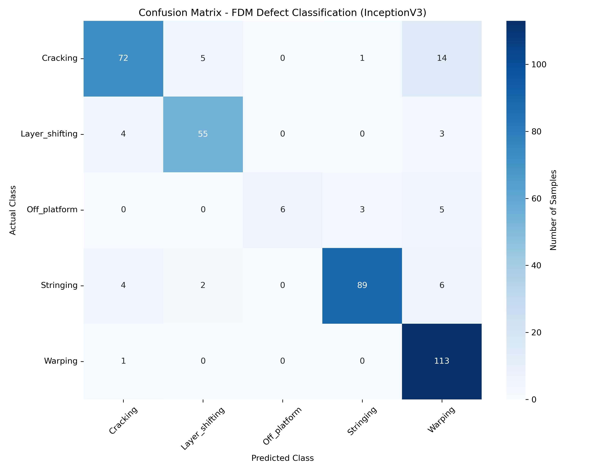

# FDM 3D Printer Defect Classification – Technical Report
## Model: InceptionV3

---

## 1. Problem Statement

The aim of this project is to automatically classify 3D-printed parts into multiple defect categories using images. Manual visual inspection of every printed object is time-consuming, subjective, and difficult to scale. A robust computer-vision model can support or partially automate quality control by detecting and categorizing common FDM defects.

Formally, given an input image **x** of a printed part, the system predicts a label **y ∈ {Cracking, Layer\_shifting, Off\_platform, Stringing, Warping}**.

---

## 2. Dataset Description

- **Source:** Local image dataset organized in folders by class (compatible with `ImageFolder`).
- **Classes:**
  - Cracking
  - Layer\_shifting
  - Off\_platform
  - Stringing
  - Warping
- **Total images:** 1,912
  - Training set: 1,529 images (≈ 80%)
  - Validation set: 383 images (≈ 20%)

The dataset is loaded from a root directory `data/`, where each subfolder name corresponds to a defect class. A fixed random seed (42) is used when splitting the full dataset into training and validation subsets to ensure that results are reproducible.

---

## 3. Data Pre-Processing

Each image is passed through a pre-processing pipeline before being fed to the neural network:

- **Resizing:** Every image is resized to **299 × 299** pixels to match the input size required by InceptionV3.
- **Conversion to tensor:** Images are converted to PyTorch tensors, enabling GPU-accelerated operations.
- **Normalization:** Pixel values are normalized channel-wise using the standard ImageNet mean `[0.485, 0.456, 0.406]` and standard deviation `[0.229, 0.224, 0.225]`.

These steps ensure that:

- The inputs are in the correct spatial resolution and numeric range for the pre-trained model.
- The data distribution is compatible with the ImageNet-pretrained weights, which helps transfer learning work effectively.
- Training is numerically stable and converges smoothly.

---

## 4. Model Architecture

The model is based on **InceptionV3**, a deep convolutional neural network originally trained on the ImageNet dataset. InceptionV3 is notable for its use of factorized convolutions, batch normalization, and an **auxiliary classifier branch** (`AuxLogits`) that provides an additional gradient signal during training.

The following modifications are made for this task:

- The entire convolutional feature extractor (Inception modules, pooling layers, batch normalization) is reused unchanged. These layers produce rich, high-level visual representations capturing edges, textures, and shapes at multiple scales.
- **Two classifier heads are replaced:**
  - The **main classifier** (`model.fc`): the original 1,000-class fully connected layer is replaced with a new `Linear` layer outputting 5 scores — one per FDM defect class.
  - The **auxiliary classifier head** (`model.AuxLogits.fc`): similarly replaced with a new `Linear` layer outputting 5 scores.
- All layers **except** `fc` and `AuxLogits` are frozen; only the two new classifier heads are trainable.

Conceptually:

> **Input image → frozen InceptionV3 feature extractor → 5-class main classifier → softmax probabilities over the five defect types**
> *(+ auxiliary branch active during training only)*

**Trainable parameters:** 2,571,786

This is a standard transfer learning setup:

- It avoids training a very deep network from scratch on a relatively small dataset.
- It allows the model to benefit from rich, generic visual features learned from ImageNet.
- It reduces overfitting risk and shortens training time.

---

## 5. Training Configuration

| Parameter | Value |
|---|---|
| Framework | PyTorch (with Torchvision) |
| Random seed | 42 |
| Batch size | 32 |
| Maximum epochs | 10 |
| Optimizer | Adam |
| Learning rate | 0.0001 |
| Loss function | Cross-entropy loss |
| Early stopping patience | 3 epochs |

**Device selection priority:**
1. Apple MPS GPU (if available)
2. CUDA GPU
3. CPU

Only the two classifier heads (`fc` and `AuxLogits.fc`) have their parameters updated; all Inception feature-extraction layers remain frozen. This greatly reduces the number of trainable parameters and helps the model generalize well on the available data.

---

## 6. Training Procedure

For each epoch, the training loop consists of two phases: training and validation.

### 1. Training phase

- The model is put into training mode.
- Mini-batches of training images and labels are loaded.
- For each batch:
  - Images and labels are moved to the selected device (MPS, CUDA, or CPU).
  - A forward pass produces outputs. In training mode, **InceptionV3 returns a named tuple `(main_logits, aux_logits)`**.
  - The **combined loss** is computed as:
    > `loss = CrossEntropy(main_logits, labels) + 0.4 × CrossEntropy(aux_logits, labels)`
    
    The 0.4 weight follows Google's TensorFlow Inception-v3 training code and the PyTorch fine-tuning tutorial (the Inception-v3 paper itself gives no numeric weight; GoogLeNet used 0.3).
  - Backpropagation computes gradients for the trainable parameters.
  - The optimizer updates the two classifier head weights.
- After all batches are processed, the average training loss and training accuracy for that epoch are computed. The accuracy is based on `argmax(main_logits)` only.

### 2. Validation phase

- The model is switched to evaluation mode. In this mode, **InceptionV3 outputs only the main logits** (no auxiliary output).
- Gradient computation is disabled to save memory and computation.
- The validation set is processed in batches:
  - For each batch, logits and loss (main only) are computed, but no gradients or updates are performed.
  - Predictions are obtained by taking the `argmax` of the logits along the class dimension.
- The average validation loss and validation accuracy for the epoch are reported.

Tracking both training and validation metrics across epochs allows monitoring of learning progress and early detection of overfitting.

---

## 7. Early Stopping and Checkpointing

To prevent overfitting and avoid unnecessary epochs, an early stopping strategy with model checkpointing is used:

- After every epoch, the current validation loss is compared to the best validation loss seen so far.
- **If the validation loss improves:**
  - The current model weights are saved as the best model (file: `inception_v3_best_model.pth`).
  - The early-stopping counter is reset to zero.
- **If the validation loss does not improve:**
  - The early-stopping counter is incremented.
  - Once the counter reaches the patience value (3 epochs), training is stopped early.
- After training ends, the best saved weights are reloaded, ensuring that the final model corresponds to the epoch with the lowest validation loss.

In this experiment:

- Validation loss improved on **every single epoch** across all 10 epochs — early stopping was never triggered.
- The best validation loss (**≈ 0.7494**) was achieved at **epoch 10**.
- The model weights from epoch 10 are saved and used as the final model for evaluation.

---

## 8. Experimental Results

### 8.1 Epoch-wise Performance

| Epoch | Train Loss | Train Acc | Val Loss | Val Acc |
|:-----:|:----------:|:---------:|:--------:|:-------:|
| 1  | 1.7070 | 30.54% | 1.3802 | 51.96% |
| 2  | 1.4044 | 47.22% | 1.2632 | 63.45% |
| 3  | 1.2815 | 58.21% | 1.1603 | 70.76% |
| 4  | 1.1863 | 64.49% | 1.0734 | 76.24% |
| 5  | 1.0947 | 70.37% | 0.9979 | 76.76% |
| 6  | 1.0389 | 71.48% | 0.9402 | 81.20% |
| 7  | 0.9764 | 75.02% | 0.8827 | 81.98% |
| 8  | 0.9150 | 76.52% | 0.8270 | 81.20% |
| 9  | 0.8734 | 78.81% | 0.7859 | 87.21% |
| 10 | 0.8320 | 81.36% | 0.7494 | **87.47%** |

Key observations:

- Training accuracy grew steadily from ≈ 30% to ≈ 81% over 10 epochs, reflecting ongoing learning by the classifier heads.
- Validation accuracy improved from ≈ 52% to ≈ 87%, with a notable jump between epoch 8 and epoch 9.
- Both training and validation losses decreased consistently across all epochs — early stopping was not triggered.
- The gap between training and validation accuracy narrowed over time, suggesting the model generalizes well given the frozen backbone.

### 8.2 Final Validation Performance

After training, the best checkpoint (`inception_v3_best_model.pth`, from epoch 10) is reloaded and evaluated on the validation set:

| Metric | Value |
|---|---|
| Validation loss | ≈ 0.7494 |
| Validation accuracy | ≈ **87.47%** |
| Correct predictions | 335 / 383 |
| Misclassified images | 48 / 383 |

---

## 9. Confusion Matrix and Error Analysis

A multi-class confusion matrix provides deeper insight into how the model performs on each defect category. For five classes it is a **5 × 5** table where:

- Each **row** corresponds to the true (actual) class.
- Each **column** corresponds to the predicted class.
- **Diagonal entries** represent correct predictions.
- **Off-diagonal entries** represent misclassifications.

### Confusion Matrix

|                     | **Cracking** | **Layer\_shifting** | **Off\_platform** | **Stringing** | **Warping** |
|---------------------|:------------:|:-------------------:|:-----------------:|:-------------:|:-----------:|
| **Cracking**        | 72           | 5                   | 0                 | 1             | 14          |
| **Layer\_shifting** | 4            | 55                  | 0                 | 0             | 3           |
| **Off\_platform**   | 0            | 0                   | 6                 | 3             | 5           |
| **Stringing**       | 4            | 2                   | 0                 | 89            | 6           |
| **Warping**         | 1            | 0                   | 0                 | 0             | 113         |

The following code is used in the notebook to compute and print the confusion matrix:

```python
from sklearn.metrics import confusion_matrix, classification_report
import numpy as np

model.eval()
all_preds, all_labels = [], []
with torch.no_grad():
    for inputs, labels in val_loader:
        inputs, labels = inputs.to(device), labels.to(device)
        outputs = model(inputs)
        _, preds = torch.max(outputs, 1)
        all_preds.extend(preds.cpu().numpy())
        all_labels.extend(labels.cpu().numpy())

cm = confusion_matrix(all_labels, all_preds)
print("Classes:", class_names)
print("Confusion matrix:\n", cm)
```

To produce a heatmap for the report, the following code is added:

```python
import seaborn as sns
import matplotlib.pyplot as plt

plt.figure(figsize=(10, 8))
sns.heatmap(cm, annot=True, fmt='d', cmap='Blues',
            xticklabels=class_names, yticklabels=class_names,
            cbar_kws={'label': 'Number of Samples'})
plt.title('Confusion Matrix - FDM Defect Classification (InceptionV3)')
plt.xlabel('Predicted Class')
plt.ylabel('Actual Class')
plt.xticks(rotation=45)
plt.yticks(rotation=0)
plt.tight_layout()
plt.savefig('../figures/confusion_matrix_inception_v3_fdm_defects.png', dpi=300)
plt.show()
```

### Classification Report

| Class             | Precision | Recall | F1-Score | Support |
|-------------------|:---------:|:------:|:--------:|:-------:|
| Cracking          | 0.89      | 0.78   | 0.83     | 92      |
| Layer\_shifting   | 0.89      | 0.89   | 0.89     | 62      |
| Off\_platform     | 1.00      | 0.43   | 0.60     | 14      |
| Stringing         | 0.96      | 0.88   | 0.92     | 101     |
| Warping           | 0.80      | 0.99   | 0.89     | 114     |
| **Accuracy**      |           |        | **0.87** | **383** |
| Macro Avg         | 0.91      | 0.79   | 0.82     | 383     |
| Weighted Avg      | 0.88      | 0.87   | 0.87     | 383     |

### Per-Class Accuracy

| Class             | Correct / Total | Accuracy  |
|-------------------|:---------------:|:---------:|
| Cracking          | 72 / 92         | 78.26%    |
| Layer\_shifting   | 55 / 62         | 88.71%    |
| Off\_platform     | 6 / 14          | 42.86%    |
| Stringing         | 89 / 101        | 88.12%    |
| Warping           | 113 / 114       | 99.12%    |

### Error Analysis

The confusion matrix reveals several important patterns:

- **Warping** is the best-recognized class (99.12% recall). Nearly all Warping samples are correctly predicted, with only one misclassified as Cracking.
- **Stringing** performs well (88.12% recall), with small numbers of errors spread across Layer\_shifting and Warping.
- **Layer\_shifting** achieves 88.71% recall; errors are mostly confused with Cracking and Warping.
- **Cracking** has the weakest recall (78.26%), with 14 samples incorrectly predicted as Warping and 5 as Layer\_shifting. The visual similarity between large-scale cracking and warping deformations likely contributes to this confusion.
- **Off\_platform** has the lowest recall (42.86%), with 8 of 14 samples misclassified (5 as Warping, 3 as Stringing). This class has the smallest support (only 14 samples), making it the most challenging for the model to learn.

### Confusion Matrix Figure



---

## 10. Model Saving and Deployment Considerations

After training:

- The best model (epoch 10) is saved as `inception_v3_best_model.pth`.
- A final version is also saved as `inception_v3_fdm_5class_model.pth` for convenient reuse.

For deployment in a real inspection or quality-control system:

1. **Recreate the model:**
   - Initialize InceptionV3 with pretrained weights.
   - Replace `model.fc` and `model.AuxLogits.fc` with 5-class `Linear` layers.
   - Freeze the feature extractor (all parameters not in `fc` or `AuxLogits`).
2. **Load weights:**
   - Load `inception_v3_best_model.pth` into this architecture.
3. **Apply the same pre-processing:**
   - Resize to **299 × 299**, convert to tensor, normalize with ImageNet statistics.
4. **Inference:**
   - Set the model to `eval()` mode (ensures only main logits are returned, not the auxiliary output).
   - Run a forward pass to obtain class scores.
   - Choose the class with the highest score as the predicted defect type.
5. **Integration:**
   - Wrap the model into a service (e.g., web API, on-device app) that receives images from cameras or uploaded files.
   - Optionally use probability thresholds (from `softmax` of the logits) to decide when to flag prints for manual inspection.

Maintaining identical pre-processing steps and the correct model mode (`eval()`) between training and deployment is critical to ensure that real-world predictions match the performance observed during validation.

---

## 11. Discussion

### Strengths of the approach

- **Solid accuracy:** ≈ 87.47% overall on the validation set using a frozen InceptionV3 backbone trained for only 10 epochs.
- **Data efficiency:** Transfer learning avoids the need to train InceptionV3's 27-million-parameter backbone from scratch on a modest dataset of 1,912 images.
- **Auxiliary classifier:** InceptionV3's built-in auxiliary branch provides extra gradient signal during training, helping the classifier heads converge even though the backbone is frozen.
- **Steady improvement:** Validation loss decreased in every epoch without a single plateau, indicating that more training could potentially yield further gains.

### Limitations

- **Overall accuracy is notably lower than AlexNet** on this dataset (87.47% vs AlexNet's 99.22% best validation accuracy; 98.96% for its saved checkpoint). While InceptionV3 is architecturally more powerful in general, its much larger and more abstract feature space may not transfer as cleanly to FDM defect images with only a frozen backbone.
- **Off\_platform performance is poor** (42.86% recall, 14 samples). The very small support for this class makes it difficult for any classifier head to learn a reliable decision boundary.
- **Cracking vs. Warping confusion:** 14 Cracking images are predicted as Warping, suggesting visual overlap between these two defect types that the frozen features do not clearly separate.
- The evaluation is performed on a validation split from the same dataset. Performance on unseen conditions (different printers, materials, lighting, or cameras) is not yet quantified.
- The model only performs image-level classification; it does not localize which region of the print is defective.

### Potential improvements

- **Fine-tuning deeper layers:** Unfreezing the later Inception blocks and fine-tuning with a small learning rate could allow the model to adapt its feature representations more specifically to FDM defect textures, potentially closing the gap with AlexNet.
- **Data augmentation:** Apply random rotations, flips, crops, color jitter, and other transformations to improve robustness and help the model distinguish visually similar classes (e.g., Cracking vs. Warping).
- **Class balancing:** Off\_platform has only 14 samples. Oversampling, synthetic data generation, or weighted loss functions could improve recall for this underrepresented class.
- **Extended training:** Since validation loss was still decreasing at epoch 10 with no sign of convergence, additional epochs or a learning rate schedule could yield higher accuracy.
- **External test set:** Evaluate on images collected from different printers and environments to validate generalization.
- **Explainability:** Use Grad-CAM to visualize which regions of the image drive each prediction, helping to understand and debug class confusions.
- **Model comparison:** The AlexNet baseline already reaches 99.22% best validation accuracy (98.96% saved checkpoint) with a simpler, shallower architecture. This suggests that for this specific dataset, a well-matched simpler backbone can outperform a more complex one when only the classifier head is trained.

---

## 12. Conclusion

This project applies transfer learning with **InceptionV3** to multi-class FDM 3D-printer defect classification. By reusing a frozen Inception backbone and training lightweight 5-class classifier heads (main + auxiliary), the system:

- Achieves ≈ **87.47% accuracy** on a held-out validation set of 383 images.
- Correctly classifies **335 out of 383 images**, misclassifying 48.
- Demonstrates **steady learning across all 10 epochs**, with validation loss improving each epoch and no early stopping triggered.
- Performs strongly on high-support classes (**Warping at 99.12%**, Stringing at 88.12%) but struggles with the small **Off\_platform** class (42.86% recall) and the visually overlapping **Cracking / Warping** pair.

Compared to the AlexNet baseline (99.22% best validation accuracy; 98.96% saved checkpoint), InceptionV3 with a fully frozen backbone underperforms on this dataset. This highlights that architectural complexity does not always translate to better transfer learning outcomes — the degree of feature alignment between the source domain (ImageNet) and target domain (FDM defect images) matters significantly. Fine-tuning deeper layers, addressing class imbalance, and applying stronger data augmentation are the most promising paths to improvement.
